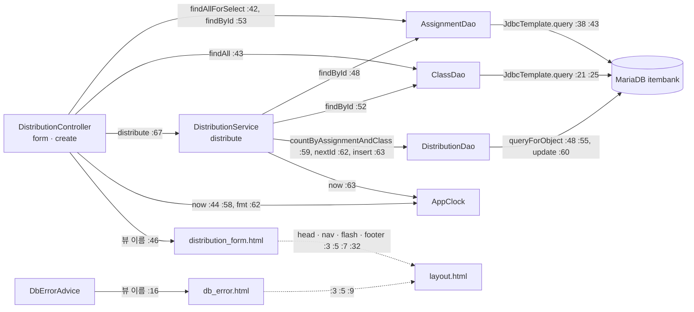

# legacy/assignment-thymeleaf 아키텍처 — 배포 등록 화면

> 분석 범위: **배포 등록 화면**(`GET /distributions/new`, `POST /distributions`)과 이 화면이 부르는 코드까지만. 끝낸 단계: 진입점 · 의존 관계. 데이터 흐름은 [ERD.md](ERD.md), 비즈니스 규칙은 [BUSINESS-RULES.md](BUSINESS-RULES.md) 에 있다.
> 분석하지 않음: 배포 목록(`GET /distributions`), 재배포(`POST /distributions/{id}/redistribute`), 과제 목록(`AssignmentController`, `/assignments`).
> 근거는 `파일:줄번호` 다. Java 파일은 `legacy/assignment-thymeleaf/src/main/java/com/example/assign/` 아래 경로(예: `web/DistributionController.java:40`), 템플릿 · 설정은 `legacy/assignment-thymeleaf/src/main/resources/` 아래 경로(예: `templates/distribution_form.html:8`), 그 밖의 모듈 파일은 `legacy/assignment-thymeleaf/` 기준, 저장소 파일은 루트 기준으로 적는다.

## 1. 모듈 개요

- 과제를 학급에 배포하는 Spring Boot 3.3.4 · Java 17 · Thymeleaf 화면 모듈이다(`build.gradle:3`, `build.gradle:11`, `build.gradle:26`).
- DB 접근은 JPA 없이 `JdbcTemplate` 으로 한다(`build.gradle:27`, `dao/AssignmentDao.java:15`). 드라이버는 MariaDB 다(`build.gradle:28`, `application.properties:5`).
- compose 에서 `assignment` 서비스(프로필 `thymeleaf`)로 뜨고, 호스트 8082 → 컨테이너 8080 이다(`docker-compose.yml:50-54`). DB 는 `mariadb` 컨테이너의 `itembank` 다(`docker-compose.yml:61`).
- 현재 시각은 `AppClock.now()` 가 준다. 시스템 속성 `app.clock=system` 이 없으면 `2026-09-15 00:00:00` 고정값을 돌려준다(`AppClock.java:9`, `AppClock.java:14-20`).
- 호출 계층: `web`(컨트롤러 · 예외 처리) → `service` → `dao`. `model`(행 객체, 로직 없음)은 세 계층이 함께 쓴다. 배포 등록 화면에서는 컨트롤러가 서비스와 DAO 를 **둘 다** 직접 부른다(`web/DistributionController.java:42-43`, `:53`, `:67`).

## 2. 폴더 구조 (범위 안 파일에 ●)

```
legacy/assignment-thymeleaf/
├── build.gradle                        38줄   의존성 · Java 17
├── Dockerfile                          11줄   bootJar → assignment.jar 실행
└── src/main/
    ├── java/com/example/assign/
    │   ├── AssignApplication.java      12줄 ● main
    │   ├── AppClock.java               28줄 ● 고정 시각 · 날짜 형식
    │   ├── web/
    │   │   ├── DistributionController  101줄 ● form · create (list · redistribute 는 범위 밖)
    │   │   ├── DbErrorAdvice            18줄 ● DataAccessException → db_error 화면
    │   │   └── AssignmentController     35줄   범위 밖
    │   ├── service/
    │   │   └── DistributionService     701줄 ● distribute(:46-68) 만. redistribute(:70~) 는 범위 밖
    │   ├── dao/
    │   │   ├── AssignmentDao            66줄 ● findAllForSelect · findById
    │   │   ├── ClassDao                 42줄 ● findAll · findById
    │   │   └── DistributionDao         108줄 ● countByAssignmentAndClass · nextId · insert
    │   └── model/
    │       ├── AssignmentRow            79줄 ● 필드 + getter/setter
    │       ├── ClassRow                 32줄 ● 필드 + getter/setter
    │       └── DistributionRow · RedistributeResult · SubmissionRow   범위 밖
    └── resources/
        ├── application.properties       14줄 ● 접속 · Hikari
        └── templates/
            ├── distribution_form.html   34줄 ● 배포 등록 폼
            ├── layout.html              37줄 ● head · nav · flash · footer 조각
            ├── db_error.html            11줄 ● DB 오류 화면
            └── distributions.html · assignments.html   범위 밖
src/test/java/com/example/assign/AppClockTest.java   20줄   범위 밖
```

## 3. 진입점

| URL / 화면 | 처음 실행되는 코드 | 주요 호출 (순서대로) |
|---|---|---|
| 애플리케이션 시작 | `AssignApplication.main` | `SpringApplication.run` `AssignApplication.java:9-11` |
| `GET /distributions/new` (배포 등록 폼) | `DistributionController.form` `web/DistributionController.java:40-47` | `assignmentDao.findAllForSelect()` `:42` → `classDao.findAll()` `:43` → `AppClock.now()` `:44` → 뷰 `distribution_form` `:46`. 템플릿은 `layout` 조각 `head` · `nav` · `flash` · `footer` 를 끼운다(`templates/distribution_form.html:3`, `:5`, `:7`, `:32`) |
| `POST /distributions` (배포 등록 처리) | `DistributionController.create` `web/DistributionController.java:49-77` | `assignmentDao.findById` `:53` → 없으면 flash `error` 후 `redirect:/distributions/new` `:54-57` → `AppClock.now()` `:58` → 마감 검사 `:60-65` → `distributionService.distribute` `:67` → flash `message` `:68` → `redirect:/distributions` `:76`. 예외는 `:69-75` 에서 잡아 `redirect:/distributions/new` |
| └ `DistributionService.distribute` | `service/DistributionService.java:46-68` (`@Transactional`) | `assignmentDao.findById` `:48` → `classDao.findById` `:52` → 상태 `D` 검사 `:56` → `distributionDao.countByAssignmentAndClass` `:59` → `distributionDao.nextId` `:62` → `distributionDao.insert(…, AppClock.now())` `:63` → 반환 행 수 검사 `:64` |
| `DataAccessException` 이 컨트롤러 밖으로 나갈 때 | `DbErrorAdvice.dbError` `web/DbErrorAdvice.java:11-17` | `System.out.println` 으로 원인 출력 `:13` → 뷰 `db_error` `:16` |

- `GET /distributions/new` 에는 `try` 가 없어서 DAO 의 `DataAccessException` 은 `DbErrorAdvice` 로 간다(`web/DistributionController.java:40-47`).
- `POST /distributions` 의 첫 조회 `assignmentDao.findById`(`:53`)는 `try`(`:66`) 밖에 있다. 여기서 난 `DataAccessException` 은 `:72` 에서 잡히지 않고 `DbErrorAdvice` 로 간다. 코드로 본 결과이고 실행해 보지는 않았다.
- 메뉴 링크 `새 배포` 가 이 화면으로 온다(`templates/layout.html:26`).

## 4. 의존 관계

화살표는 "호출하는 쪽 → 호출되는 쪽"이다. 라벨의 줄번호는 호출하는 쪽 파일의 호출 줄이다. 템플릿 조각 끼우기(`th:replace`)는 점선으로 그렸다.



| 호출하는 쪽 | 호출되는 쪽 | 근거 |
|---|---|---|
| `DistributionController.form` | `AssignmentDao.findAllForSelect` · `ClassDao.findAll` · `AppClock.now` | `web/DistributionController.java:42`, `:43`, `:44` |
| `DistributionController.create` | `AssignmentDao.findById` · `AppClock.now` · `AppClock.fmt` · `DistributionService.distribute` | `web/DistributionController.java:53`, `:58`, `:62`, `:67` |
| `DistributionService.distribute` | `AssignmentDao.findById` · `ClassDao.findById` | `service/DistributionService.java:48`, `:52` |
| `DistributionService.distribute` | `DistributionDao.countByAssignmentAndClass` · `nextId` · `insert` | `service/DistributionService.java:59`, `:62`, `:63` |
| `DistributionService.distribute` | `AppClock.now`(배포 시각) | `service/DistributionService.java:63` |
| `AssignmentDao` · `ClassDao` · `DistributionDao` | Spring `JdbcTemplate`(생성자 주입) | `dao/AssignmentDao.java:17-19`, `dao/ClassDao.java:16-18`, `dao/DistributionDao.java:19-21` |
| `DbErrorAdvice.dbError` | `System.out.println` · 뷰 `db_error` | `web/DbErrorAdvice.java:13`, `:16` |
| `templates/distribution_form.html` | `layout.html` 조각 `head` · `nav` · `flash` · `footer` | `templates/distribution_form.html:3`, `:5`, `:7`, `:32`, 정의 `templates/layout.html:3`, `:23`, `:28`, `:35` |

외부 라이브러리 · 설정

| 대상 | 쓰는 곳 | 근거 |
|---|---|---|
| `spring-boot-starter-web` · `-thymeleaf` · `-jdbc` | 컨트롤러 · 템플릿 · DAO | `build.gradle:25-27` |
| `mariadb-java-client` | JDBC 드라이버 | `build.gradle:28`, `application.properties:5` |
| 접속 정보 · Hikari(최대 4, 대기 5초) | `JdbcTemplate` 의 데이터소스 | `application.properties:2-8` |
| 트랜잭션 | `distribute` 에 `@Transactional` | `service/DistributionService.java:46` |
| Thymeleaf `#temporals.format` | 과제 선택지의 마감 표시 | `templates/distribution_form.html:17` |

관찰

- `DistributionController` 는 `AssignmentDao` · `ClassDao` 를 생성자로 주입받아 직접 부른다(`web/DistributionController.java:23-29`). 과제 조회는 컨트롤러(`:53`)와 서비스(`service/DistributionService.java:48`)에서 한 요청에 두 번 일어난다.
- `DistributionController` 는 `RedistributeResult` 를 import 하지만(`:7`) 범위 안 메서드(`form` · `create`)에서는 쓰지 않는다. 범위 밖 `redistribute`(`:84`)가 쓴다.
- `AssignmentRow` · `ClassRow` 는 필드와 getter/setter 만 있다(`model/AssignmentRow.java:7-78`, `model/ClassRow.java:5-31`). 로직이 없다.

## 5. 미확인 목록

| 항목 | 이유 |
|---|---|
| `POST /distributions` 첫 조회(`:53`)에서 난 DB 예외가 실제로 `db_error` 화면으로 가는지 | `try`(`:66`) 밖이라 `DbErrorAdvice` 로 갈 것으로 읽었지만 실행해 보지 않았다 |
| `redirect:/distributions` 뒤 목록 화면 동작 | 범위 밖이라 `list`(`:32-38`) · `distributions.html` 을 읽지 않았다 |
| 운영에서 `app.clock=system` 을 주는지 | `Dockerfile:11` 의 실행 명령에는 없다. 다른 배포 설정은 이 모듈 안에 없다 |
| `DistributionService` 의 나머지(`:70-701`)가 `distribute` 에 영향을 주는지 | `distribute`(`:46-68`)만 읽었다. 필드 · 생성자(`:28-36`) 외 공유 상태는 확인하지 않았다 |
