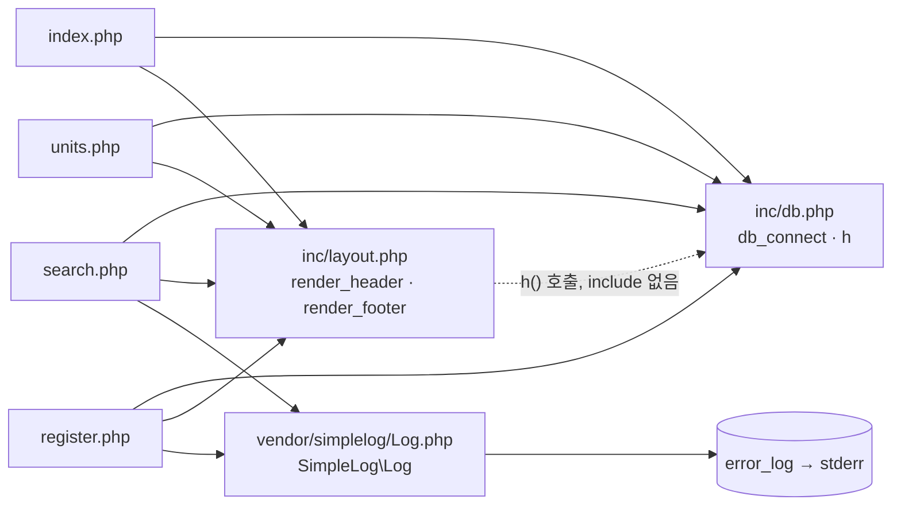

# legacy/item-bank-php 아키텍처

> 분석 범위: 진입점 · 의존 관계. 데이터 흐름 · 비즈니스 규칙은 아직 분석하지 않았다.
> 모든 근거는 `파일:줄번호` 이며, 경로는 `legacy/item-bank-php/` 기준이다.

## 1. 모듈 개요

- 문항 검색 · 등록 · 단원 목록을 보여 주는 PHP 화면 모듈이다. PHP 파일 6개, 합계 1,050줄이다.
- `php:7.4-apache` 이미지에서 `mysqli` 로 DB 에 붙는다(`Dockerfile:1`, `Dockerfile:3`).
- 라우터 · 프레임워크 없이 화면 파일마다 따로 진입점이다. 각 화면이 SQL 을 직접 실행한다.
- 공통 코드는 `inc/db.php`(접속 · `h()`), `inc/layout.php`(머리말 · 꼬리말) 두 파일이다.
- `search.php` 한 파일이 731줄로 모듈의 70%를 차지한다.

## 2. 폴더 구조

```
legacy/item-bank-php/
├── Dockerfile               16줄   php:7.4-apache, mysqli, 모듈 전체를 /var/www/html/ 로 복사
├── index.php                14줄   홈(메뉴)
├── units.php                48줄   단원 목록
├── search.php              731줄   문항 검색 (함수 4개)
├── register.php            177줄   문항 등록
├── inc/
│   ├── db.php               37줄   db_connect(), h()
│   └── layout.php           43줄   render_header(), render_footer()
└── vendor/
    └── simplelog/Log.php    54줄   외부 라이브러리(더미). error_log 로만 기록
```

## 3. 진입점

`Dockerfile:14` 가 모듈 전체를 `/var/www/html/` 에 복사하므로 URL 경로와 파일 경로가 1:1로 대응한다.

| URL / 화면 | 처음 실행되는 파일 | 주요 함수 호출 (순서대로) |
|---|---|---|
| `/index.php` (홈, 메뉴) | `index.php` | `render_header('홈')` `index.php:5` → 메뉴 링크 3개 출력 `index.php:9-11` → `render_footer()` `index.php:14`. DB 조회 없음 |
| `/units.php` (단원 목록) | `units.php` | `render_header` `units.php:5` → `db_connect()` `units.php:8` → `$conn->query(단원별 공개 문항 수 SQL)` `units.php:16-20` → `h()` 로 표 출력 `units.php:40-43` → `render_footer` `units.php:48` |
| `/search.php` (문항 검색, GET) | `search.php` | `Log::setThreshold` `search.php:27` → `render_header` `search.php:709` → `db_connect()` `search.php:713` → `buildSearchQuery($_GET, $conn)` `search.php:722` → `renderSearchForm` `search.php:723` → `runSearchQuery` `search.php:724` → `renderResultTable` `search.php:725` → 실패하면 `Log::error` `search.php:727` → `render_footer` `search.php:731` |
| `/register.php` GET (등록 폼) | `register.php` | `db_connect()` `register.php:17` → 단원 · 태그 목록 조회 `register.php:27`, `register.php:34` → `render_header` `register.php:127` → 폼 출력 `register.php:141-175` → `render_footer` `register.php:177` |
| `/register.php` POST (등록 처리) | `register.php` | GET 흐름에 더해 `$_POST` 5개 값 읽기 `register.php:41-45` → 검증 `register.php:49-81` → `begin_transaction` `register.php:85` → 다음 id 를 `MAX(id)+1 … FOR UPDATE` 로 구함 `register.php:87` → `INSERT item` `register.php:92-99` → `INSERT item_tag` `register.php:105-110` → `commit` `register.php:114` → `Log::info` `register.php:115`. 실패하면 `rollback` · `Log::error` `register.php:120-121` |
| `/` (루트) | 미확인 | 아래 6절 참고 |

- 메뉴에서 링크하는 화면은 `search.php` · `register.php` · `units.php` 3개다(`index.php:9-11`, `inc/layout.php:10-12`).

## 4. 의존 관계



실선은 include / require 와 그 파일의 함수 호출이다. 점선은 include 없이 함수만 호출하는 관계다.

### include / require

| 방향 (A → B: A 가 B 를 포함) | 근거 |
|---|---|
| `index.php` → `inc/db.php` | `index.php:2` |
| `index.php` → `inc/layout.php` | `index.php:3` |
| `units.php` → `inc/db.php` | `units.php:2` |
| `units.php` → `inc/layout.php` | `units.php:3` |
| `register.php` → `inc/db.php` | `register.php:2` |
| `register.php` → `inc/layout.php` | `register.php:3` |
| `register.php` → `vendor/simplelog/Log.php` | `register.php:4` (`use` 는 `register.php:6`) |
| `search.php` → `inc/db.php` | `search.php:20` |
| `search.php` → `inc/layout.php` | `search.php:21` |
| `search.php` → `vendor/simplelog/Log.php` | `search.php:22` (`use` 는 `search.php:24`) |

### 함수 호출

| 방향 (A → B: A 가 B 를 호출) | 호출 대상 | 근거 |
|---|---|---|
| `inc/layout.php` → `inc/db.php` | `h()` | `inc/layout.php:17`, `inc/layout.php:33` |
| `units.php` · `register.php` · `search.php` → `inc/db.php` | `db_connect()` | `units.php:8`, `register.php:17`, `search.php:713` |
| 화면 파일 → `inc/db.php` | `h()` | 예: `units.php:10`, `register.php:131`, `search.php:715`. `index.php` 는 `render_header` 를 거쳐서만 호출 |
| 화면 4개 → `inc/layout.php` | `render_header` · `render_footer` | `index.php:5,14`, `units.php:5,48`, `register.php:127,177`, `search.php:709,731` |
| `register.php` → `Log` | `Log::info` · `Log::error` | `register.php:115`, `register.php:121` |
| `search.php` → `Log` | `setThreshold` · `debug` · `error` | `search.php:27`, `search.php:103`, `search.php:528`, `search.php:537`, `search.php:727` |
| `search.php` 의 `buildSearchQuery` → `inc/db.php` | `h()` | 예: `search.php:360`, `search.php:416`, `search.php:457` |
| `search.php` 실행부 → 같은 파일 함수 | `buildSearchQuery` → `renderSearchForm` → `runSearchQuery` → `renderResultTable` | `search.php:722-725` |
| `vendor/simplelog/Log.php` → PHP 내장 | `error_log` (stderr 로 출력) | `vendor/simplelog/Log.php:52`, `Dockerfile:11` |

### 숨은 결합

`inc/layout.php` 는 `h()` 를 호출하지만(`inc/layout.php:17`, `inc/layout.php:33`) `inc/db.php` 를 스스로 include 하지 않는다. `h()` 의 정의는 `inc/db.php:34-37` 에 있다. 호출하는 쪽이 `db.php` 를 먼저 include 해야 동작한다. 지금은 화면 4개가 모두 `db.php` 를 먼저 include 해서(`index.php:2`, `units.php:2`, `register.php:2`, `search.php:20`) 문제가 드러나지 않는다.

## 5. 가장 긴 함수 3개

| 순위 | 파일 | 함수 | 시작 – 끝 | 길이 | 하는 일 |
|---|---|---|---|---|---|
| 1 | `search.php` | `buildSearchQuery` | `search.php:42` – `search.php:564` | 523줄 | GET 파라미터로 검색 SQL · 건수 SQL · 바인딩 값을 조립하고, 폼 · 정렬 링크 · 경고 HTML 까지 만들어 배열로 돌려준다(`search.php:29-40`) |
| 2 | `search.php` | `renderResultTable` | `search.php:647` – `search.php:704` | 58줄 | 결과 건수 · 결과 표 · 페이지 이동 링크를 출력하고, 0건이면 안내 문구를 출력한다(`search.php:655-658`) |
| 3 | `search.php` | `runSearchQuery` | `search.php:571` – `search.php:624` | 54줄 | 건수 쿼리와 목록 쿼리를 prepared statement 로 차례로 실행해 `total` · `rows` 를 돌려준다(`search.php:577-623`) |

- 그다음은 `render_header` 30줄(`inc/layout.php:7-36`), `db_connect` 23줄(`inc/db.php:7-29`)이다.
- `buildSearchQuery` 한 함수가 모듈 전체의 절반이다. 입력 정제 · SQL 조립 · 셀렉트 박스 옵션 조회(`search.php:125`, `search.php:156`, `search.php:178`) · HTML 생성이 섞여 있다.

## 6. 미확인 목록

| 항목 | 이유 |
|---|---|
| `/` 요청이 `index.php` 로 연결되는지 | 저장소에 `DirectoryIndex` 설정이 없다. 베이스 이미지 기본값에 달려 있다 |
| `inc/*.php` · `vendor/simplelog/Log.php` 를 URL 로 직접 요청했을 때의 응답 | 웹 루트에 복사되지만(`Dockerfile:14`) 실제로 요청해 보지 않았다. 함수 · 클래스 정의만 있어 출력은 없을 것으로 보인다 |
| `a2enmod rewrite` 가 실제로 쓰이는지 | `Dockerfile:4` 에서 켜지만 모듈 안에 `.htaccess` 가 없다 |
| `buildSearchQuery` 내부 세부 흐름 | `search.php:61-561` 중 함수 호출 · SQL 이 있는 줄만 검색해서 봤고, 한 줄씩 정독하지 않았다 |
