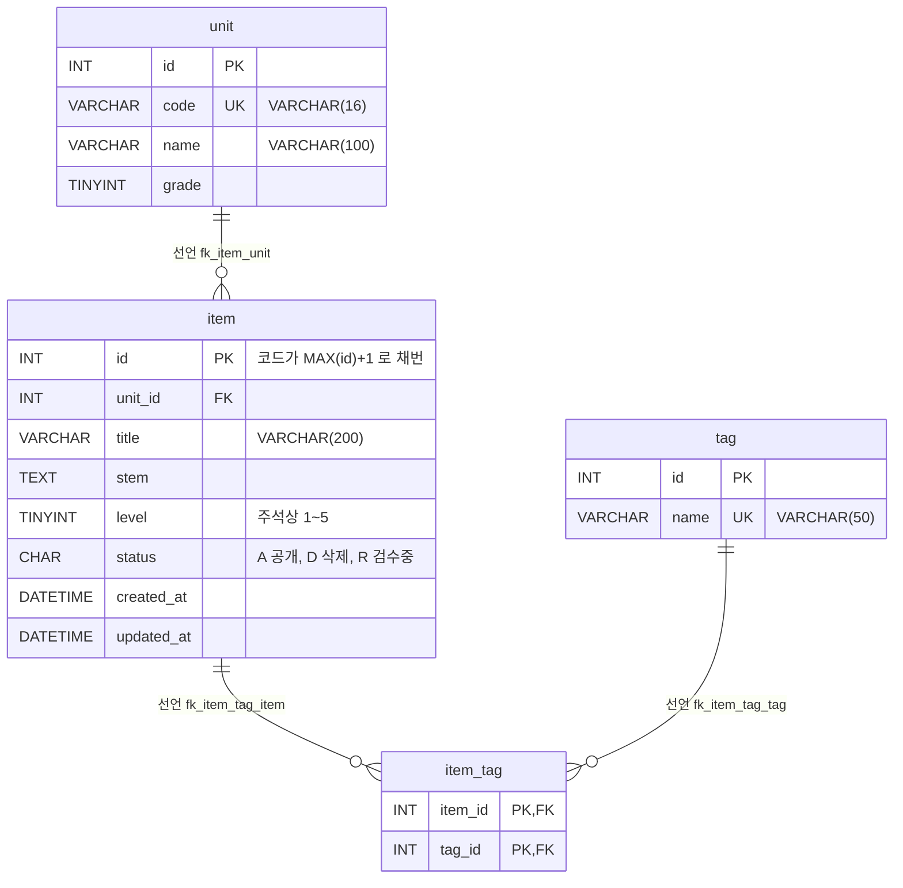

# legacy/item-bank-php 데이터 흐름 · ERD

> 분석 범위는 테이블, 관계, 읽기 · 쓰기 위치다. 진입점과 의존 관계는 [ARCHITECTURE.md](ARCHITECTURE.md) 에 있다.
> 근거는 `파일:줄번호` 로 적는다. PHP 파일은 `legacy/item-bank-php/` 기준 경로이고, 스키마 파일은 저장소 루트 기준 경로다.

## 0. 스키마의 출처

- `legacy/item-bank-php/` 안에는 스키마 정의 파일(DDL)이 없다. PHP 코드는 SQL 문만 실행한다.
- compose 에서 `item-bank` 서비스는 `DB_HOST: mariadb`, `DB_NAME: itembank` 로 접속한다(`docker-compose.yml:35-43`). `inc/db.php:14-16` 의 기본값도 `mariadb` · `itembank` 다.
- 같은 `mariadb` 컨테이너는 `db/mariadb/init` 을 초기화 스크립트로 마운트한다(`docker-compose.yml:25`). 그래서 이 문서는 `db/mariadb/init/01-schema.sql` 을 스키마 근거로 쓴다.
- 운영 DB 의 스키마가 이 파일과 같은지는 미확인이다(6절).

## 1. 테이블 목록

모듈이 쓰는 대상은 테이블 4개와 뷰 1개다.

| 이름 | 종류 | 주요 컬럼 | 키 · 제약 | 근거 |
|---|---|---|---|---|
| `unit` | 테이블 | `id` INT, `code` VARCHAR(16), `name` VARCHAR(100), `grade` TINYINT | PK `id`, UNIQUE `code` | 정의 `db/mariadb/init/01-schema.sql:11-18`. 사용 `units.php:16-19`, `register.php:27`, `search.php:125`, `search.php:156` |
| `item` | 테이블 | `id` INT, `unit_id` INT, `title` VARCHAR(200), `stem` TEXT, `level` TINYINT(주석상 1~5), `status` CHAR(1) 기본값 `'A'`(주석상 A=공개 · D=삭제 · R=검수중), `created_at` DATETIME, `updated_at` DATETIME | PK `id`, FK `unit_id` → `unit.id`, 인덱스 `unit_id` · `level` | 정의 `db/mariadb/init/01-schema.sql:20-33`. 사용 `units.php:17`, `register.php:87`, `register.php:93-94` |
| `tag` | 테이블 | `id` INT, `name` VARCHAR(50) | PK `id`, UNIQUE `name` | 정의 `db/mariadb/init/01-schema.sql:35-40`. 사용 `register.php:34`, `search.php:178`, `search.php:244-245` |
| `item_tag` | 테이블(문항 ↔ 태그 연결) | `item_id` INT, `tag_id` INT | PK (`item_id`, `tag_id`), FK `item_id` → `item.id`, FK `tag_id` → `tag.id` | 정의 `db/mariadb/init/01-schema.sql:42-48`. 사용 `register.php:105`, `search.php:244-245` |
| `v_item_public` | 뷰 | `id`, `unit_id`, `unit_code`, `unit_name`, `unit_grade`, `title`, `stem`, `level`, `created_at`, `updated_at`, `tag_names`(태그 이름을 `,` 로 이은 값) | `item.status = 'A'` 인 행만 | 정의 `db/mariadb/init/01-schema.sql:52-70`. 사용 `search.php:521-526` |

참고

- `item.level` 의 1~5 범위와 `item.status` 의 코드 값은 스키마 주석(`01-schema.sql:25-26`)에만 있다. DB 에는 `CHECK` 제약이 없다. 범위 검증은 등록 화면의 PHP 코드가 한다(`register.php:70`).
- 모든 `id` 에 `AUTO_INCREMENT` 가 없다(`01-schema.sql:12`, `:21`, `:36`). 새 문항 id 는 코드가 `MAX(id)+1` 로 정한다(`register.php:87`).
- 같은 DB 의 `class` · `assignment` · `distribution` · `submission` 테이블(`01-schema.sql:75-115`)은 이 모듈이 조회하지 않는다. 단, `assignment.unit_id` 가 `unit.id` 를 참조한다(`01-schema.sql:89`). 그래서 `unit` 은 `legacy/assignment-thymeleaf` 와 함께 쓰는 테이블이다(`legacy/assignment-thymeleaf/src/main/java/com/example/assign/dao/AssignmentDao.java:24`).

## 2. 테이블 관계

| 관계 | 구분 | 선언 근거 | 코드에서 JOIN · 조건으로 쓰는 곳 |
|---|---|---|---|
| `unit` 1 — N `item` (`item.unit_id` → `unit.id`) | 선언 | `01-schema.sql:32` | `01-schema.sql:69`(뷰의 `JOIN unit`), `units.php:17`(상관 서브쿼리 `i.unit_id = u.id`) |
| `item` 1 — N `item_tag` (`item_tag.item_id` → `item.id`) | 선언 | `01-schema.sql:46` | `01-schema.sql:67`(뷰의 `it.item_id = i.id`), `search.php:245`(`it.item_id = v_item_public.id`) |
| `tag` 1 — N `item_tag` (`item_tag.tag_id` → `tag.id`) | 선언 | `01-schema.sql:47` | `01-schema.sql:66`, `search.php:244`(둘 다 `JOIN tag t ON t.id = it.tag_id`) |

- 추정 관계는 없다. 코드의 JOIN 과 조인 조건을 모두 찾아봤고, 전부 선언된 외래 키와 같은 컬럼을 잇는다.
- `item` 과 `tag` 는 `item_tag` 를 거치는 N:M 관계다.
- `unit.code` 를 조건으로 쓰는 곳이 두 군데 있다. `search.php:118` 는 뷰의 `unit_code = ?` 로 거르고, `search.php:125` 는 `unit WHERE code = ?` 를 따로 조회한다. 두 곳 모두 사용자가 입력한 단원 코드와 비교하는 검색 조건일 뿐, 테이블 사이의 관계는 아니다.
- 뷰 `v_item_public` 은 `item` · `unit` · `item_tag` · `tag` 를 위 세 관계로 합친다(`01-schema.sql:64-69`). 다이어그램에서는 뷰를 뺐다.

## 3. 읽기 · 쓰기 위치

`units.php` 와 `register.php` 에는 함수 정의가 없어 SQL 이 파일 최상위 스크립트에서 실행된다. 표에는 "최상위"라고 적는다.

### `unit`

| 동작 | 파일 · 함수 | SQL 요지 | 근거 |
|---|---|---|---|
| 읽기 | `units.php` 최상위 | `SELECT u.id, u.code, u.name, u.grade, (공개 문항 수) FROM unit u ORDER BY u.grade, u.code` | `units.php:16-20` |
| 읽기 | `register.php` 최상위 (GET · POST 공통) | `SELECT id, code, name FROM unit ORDER BY grade, code`. 폼의 선택 목록과 `unit_id` 검증(`register.php:60-68`)에 쓴다 | `register.php:27` |
| 읽기 | `search.php` `buildSearchQuery` | `SELECT name, grade FROM unit WHERE code = ?`. 검색 요약에 단원 이름을 붙이는 데 쓴다 | `search.php:125-127` |
| 읽기 | `search.php` `buildSearchQuery` | `SELECT code, name, grade FROM unit ORDER BY grade, code`. 검색 폼의 단원 선택 목록이다 | `search.php:156` |
| 읽기(뷰 경유) | `search.php` `runSearchQuery` | `v_item_public` 이 `unit` 을 JOIN 한다(`01-schema.sql:69`) | `search.php:577`, `search.php:600` |
| 쓰기 | 없음 | 모듈 안에 `INSERT` · `UPDATE` · `DELETE unit` 이 없다. 데이터는 시드로만 들어간다(`db/mariadb/init/02-seed.sql:9`) | — |

### `item`

| 동작 | 파일 · 함수 | SQL 요지 | 근거 |
|---|---|---|---|
| 읽기 | `units.php` 최상위 | `SELECT COUNT(*) FROM item i WHERE i.unit_id = u.id AND i.status = 'A'`(단원별 공개 문항 수) | `units.php:17` |
| 읽기(잠금) | `register.php` 최상위 (POST, 트랜잭션 안) | `SELECT COALESCE(MAX(id), 0) + 1 AS next_id FROM item FOR UPDATE` | `register.php:85-90` |
| 읽기(뷰 경유) | `search.php` `runSearchQuery` | 건수 `SELECT COUNT(*) AS cnt FROM v_item_public WHERE …`, 목록 `SELECT id, title, unit_code, level, tag_names, created_at FROM v_item_public WHERE … ORDER BY … LIMIT 20 OFFSET ?`. SQL 은 `buildSearchQuery` 가 조립한다(`search.php:521-526`). 조건 컬럼은 `title` · `stem`(`search.php:98`), `unit_code`(`search.php:118`), `level`(`search.php:215`, `:218`, `:226`)이다 | `search.php:577`, `search.php:600` |
| 쓰기 | `register.php` 최상위 (POST) | `INSERT INTO item (id, unit_id, title, stem, level, status, created_at, updated_at) VALUES (?, ?, ?, ?, ?, 'R', NOW(), NOW())`. 새 문항은 늘 검수중(`R`)으로 들어간다 | `register.php:92-99` |
| 쓰기 | `UPDATE` · `DELETE` 없음 | `status` 를 `R` → `A`, 또는 `D` 로 바꾸는 코드가 모듈 안에 없다(6절) | — |

### `tag`

| 동작 | 파일 · 함수 | SQL 요지 | 근거 |
|---|---|---|---|
| 읽기 | `register.php` 최상위 (GET · POST 공통) | `SELECT id, name FROM tag ORDER BY id`. 폼의 체크박스 목록과 태그 id 검증(`register.php:74-81`)에 쓴다 | `register.php:34` |
| 읽기 | `search.php` `buildSearchQuery` | `SELECT name FROM tag ORDER BY id`. 검색 폼의 태그 선택 목록이다 | `search.php:178` |
| 읽기 | `search.php` `runSearchQuery` | 태그 조건 `EXISTS (SELECT 1 FROM item_tag it JOIN tag t ON t.id = it.tag_id WHERE it.item_id = v_item_public.id AND t.name = ?)`. 조건 문자열은 `buildSearchQuery` 가 만든다 | 조립 `search.php:244-247`, 실행 `search.php:577`, `:600` |
| 읽기(뷰 경유) | `search.php` `runSearchQuery` | 뷰의 `tag_names` 서브쿼리(`01-schema.sql:64-67`) | `search.php:521`, `:600` |
| 쓰기 | 없음 | 시드로만 들어간다(`db/mariadb/init/02-seed.sql:19`) | — |

### `item_tag`

| 동작 | 파일 · 함수 | SQL 요지 | 근거 |
|---|---|---|---|
| 읽기 | `search.php` `runSearchQuery` | 위 `tag` 표의 `EXISTS` 조건 | 조립 `search.php:244-245`, 실행 `search.php:577`, `:600` |
| 읽기(뷰 경유) | `search.php` `runSearchQuery` | 뷰의 `tag_names` 서브쿼리(`01-schema.sql:64-67`) | `search.php:600` |
| 쓰기 | `register.php` 최상위 (POST, `item` INSERT 와 같은 트랜잭션) | `INSERT INTO item_tag (item_id, tag_id) VALUES (?, ?)` 를 선택한 태그 수만큼 반복한다 | `register.php:104-113` |

### `v_item_public` (뷰)

| 동작 | 파일 · 함수 | 근거 |
|---|---|---|
| 읽기 | `search.php` `runSearchQuery`(건수 · 목록 두 번 실행) | `search.php:577`, `search.php:600`. SQL 조립은 `buildSearchQuery` `search.php:519-526` |
| 쓰기 | 없음(뷰) | — |

### 한눈에 보기

| 테이블 | `units.php` | `register.php` | `search.php` |
|---|---|---|---|
| `unit` | R | R | R (직접 2회 + 뷰) |
| `item` | R | R(`FOR UPDATE`) · **C** | R (뷰) |
| `tag` | — | R | R (직접 + `EXISTS` + 뷰) |
| `item_tag` | — | **C** | R (`EXISTS` + 뷰) |

R = SELECT, C = INSERT. 모듈 전체에 `UPDATE` · `DELETE` 문이 없다.

## 4. 흐름 요약

- 등록: `register.php` 가 `unit` · `tag` 로 폼 목록을 만든다. POST 가 들어오면 한 트랜잭션 안에서 `item` 을 `status='R'` 로 INSERT 하고, 이어서 `item_tag` 를 INSERT 한다(`register.php:85-114`). 실패하면 롤백한다(`register.php:119-120`).
- 조회: `search.php` 는 `v_item_public` 만 읽는다. 이 뷰는 `status='A'` 인 문항만 보여 준다(`01-schema.sql:70`). `units.php` 도 `status='A'` 문항만 센다(`units.php:17`).
- 그래서 등록한 문항은 `R` 로 남아 있는 동안 검색 · 단원 목록 어디에도 나오지 않는다(`register.php:84`, `register.php:116` 의 안내 문구와 같다).

## 5. 이관 때 확인할 관찰

데이터 흐름을 보다가 눈에 띈 동작이다. 버그인지 의도한 규칙인지는 판단하지 않았다.

| 관찰 | 근거 |
|---|---|
| 난이도 조건을 비우면 `level < 5` 조건이 붙어 난이도 5 문항이 빠진다. 바로 위 주석에는 "1~5 모두 포함"이라고 적혀 있다 | `search.php:213-216` |
| 새 문항 id 를 `MAX(id)+1 … FOR UPDATE` 로 정한다. DB 의 자동 증가 기능을 쓰지 않는다 | `register.php:87`, `01-schema.sql:21` |
| 키워드의 `%` · `_` 를 이스케이프하지 않아 와일드카드로 동작한다. 경고 문구만 띄운다 | `search.php:94-97` |
| 공개 기준 `status='A'` 가 뷰(`01-schema.sql:70`)와 `units.php:17` 두 곳에 따로 적혀 있다 | 같음 |

## 6. 미확인 목록

| 항목 | 이유 |
|---|---|
| `item.status` 를 `R` → `A`(검수 완료), 또는 `D`(삭제)로 바꾸는 주체 | `legacy/` · `db/` 전체에서 `UPDATE item` · `DELETE FROM item` 을 찾지 못했다. 다른 시스템이나 수작업일 수 있지만 근거가 없다 |
| `unit` · `tag` 를 추가 · 수정하는 주체 | 모듈 안에 쓰기 SQL 이 없고, 시드(`02-seed.sql:9`, `:19`)만 확인했다 |
| 운영 DB 스키마가 `db/mariadb/init/01-schema.sql` 과 같은지 | 레거시 모듈 안에 DDL 이 없다. compose 설정으로 연결 관계만 확인했다(0절) |
| `item.updated_at` 을 읽는 곳 | 모듈은 INSERT 때 `NOW()` 로 쓰기만 한다(`register.php:94`). 뷰에는 포함되지만(`01-schema.sql:63`) `search.php:521` 의 SELECT 목록에 없다. 다른 모듈에서 읽는지는 확인하지 않았다 |
| `v_item_public` 을 등록 화면도 기준으로 삼는다는 스키마 주석 | `01-schema.sql:51` 에 그렇게 적혀 있지만 `register.php` 는 뷰를 조회하지 않는다. 주석이 틀렸는지, 예전 코드 이야기인지는 확인하지 못했다 |
| `search.php` 에 다른 SQL 이 숨어 있는지 | 파일 전체에서 `SELECT` · `FROM` · `JOIN` · `INSERT` · `UPDATE` · `DELETE` · `query(` · `prepare(` 를 검색했고, 걸린 줄 주변과 `search.php:515-624` 만 읽었다. 폼 · 링크 HTML 을 만드는 나머지 줄은 한 줄씩 정독하지 않았다 |
